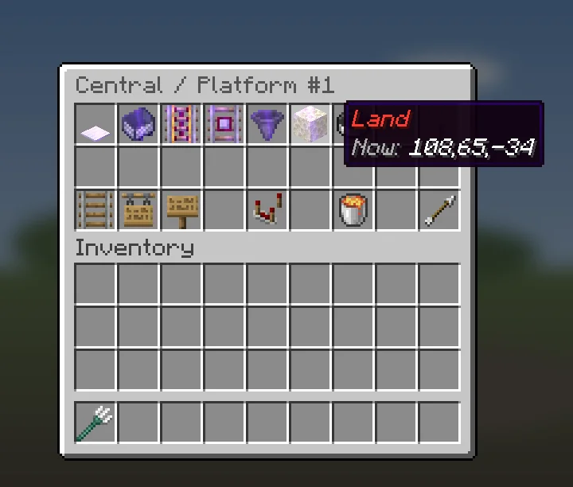
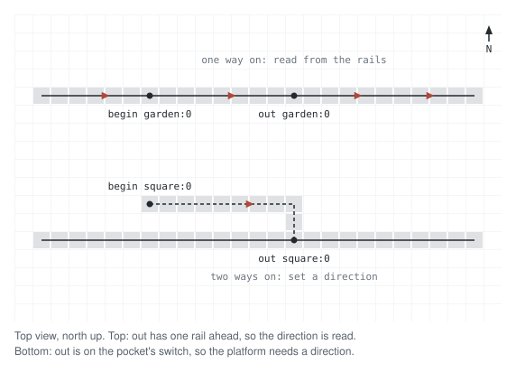

# Anchors

Anchors are points on a platform. The plugin builds every route from them.
Each platform has up to six, one per role.

| Anchor | What it is | Where to put it |
| --- | --- | --- |
| `board` | The button or pressure plate riders press. | The button or plate itself. |
| `begin` | Where the cart appears and starts. | A rail. |
| `out` | Where the cart reaches the main line. | A rail of the main line, after `begin`. |
| `in` | Where the cart leaves the main line to stop. | A rail of the main line, before `eject`. |
| `eject` | Where the cart stops. | A rail. |
| `land` | Where the rider stands after getting off. | Click the floor block. The anchor goes one block above it. |


- `board` must be a button or a pressure plate, exactly on that block. Levers
  and other blocks do not work. The editor does not check the block when you set it. No
  redstone is needed.
- `begin`, `out`, `in` and `eject` snap to the nearest rail within one block.
- On a platform with pockets, `begin` is on the boarding pocket and `out` is
  where that pocket joins the main line. `in` is where the other pocket leaves
  the main line, and `eject` is on that pocket. Either pocket can come first
  along the main line.
- On a platform on the main line, all four are on the main line, in the order
  carts pass them: `in`, `eject`, `begin`, `out`.
- Every rail anchor needs its own rail block. Two anchors on one block, or an
  anchor on a junction's block, show up in `/metro issues`.
- A detector rail under `eject` is not needed. Add one only if you want your own
  redstone to react to arriving carts.

## Not every anchor is needed

| The platform is for | It needs |
| --- | --- |
| boarding | `board`, `begin` and `out` |
| getting off | `in` and `eject`. Without `land` the rider is set down at `eject`. |

A platform with `board` and `begin` but no `out` shows
[No out anchor](Maintenance#no-out-anchor) in `/metro issues`.

A platform only for getting off has no `board`. A platform only for boarding
has no `eject`. The platforms menu shows what each platform is ready for:
`Works: boarding, alighting`.

## Set an anchor
With the crowbar ([[Editor-Mode]]):

1. Select the platform, so a left-click opens its anchor menu.
2. Look at the block for the anchor and left-click it.
3. In the top row, click the anchor: **Board**, **Begin**, **Out**, **In**,
   **Eject** or **Land**. Chat confirms it: `out central:0 = 120,64,-30`.

Anchors that are set glow, and their tooltip shows their position.



The bottom row of the anchor menu has **Lines**, **Stations** and **Platforms**
to go to those menus, then **Settings** (platform settings), **Delete** (the
platform) and **Back**.

With a command:

```
/metro anchor set <station> <platform> <role> [x y z]
/metro anchor clear <station> <platform> <role>
```

Without `x y z` the command uses the block you look at, up to 6 blocks away.
`set` can be left out, unless the station id is `set` or `clear`.

To remove an anchor in the world, right-click it with the crowbar and click
**Clear**.

After you set or clear anchors, run `/metro rebuild`.

## Direction of travel
The plugin must know which way carts run on each track. Rails do not show
that. The plugin can read it only where `out` (or `in`) has exactly one other
rail next to it. That works on a platform on the main line. On a platform with
pockets, `out` and `in` sit on the switch of a pocket, so the plugin cannot
read anything there. Such a platform needs a direction set by hand, unless
another platform on the same track already has one. When no direction reaches
a platform, `/metro issues` shows
[No direction of travel](Maintenance#no-direction-of-travel) for it. Then set
it:

1. Stand on the track and look the way carts go.
2. Click **Direction** (compass) in the platform settings.

Or use the command:

```
/metro platform heading <station> <platform> [north|east|south|west|auto]
```

Without a direction the command uses the way you face. `auto` removes the
direction. **Direction** in the anchor menu posts this command in chat.



One direction is enough for a whole track. The plugin follows the track from
that platform and gives the same direction to every point on it, through
junctions too. If two directions on one track do not agree, you see
[Opposite directions meet](Maintenance#opposite-directions-meet).

Run `/metro rebuild` after you change a direction.
