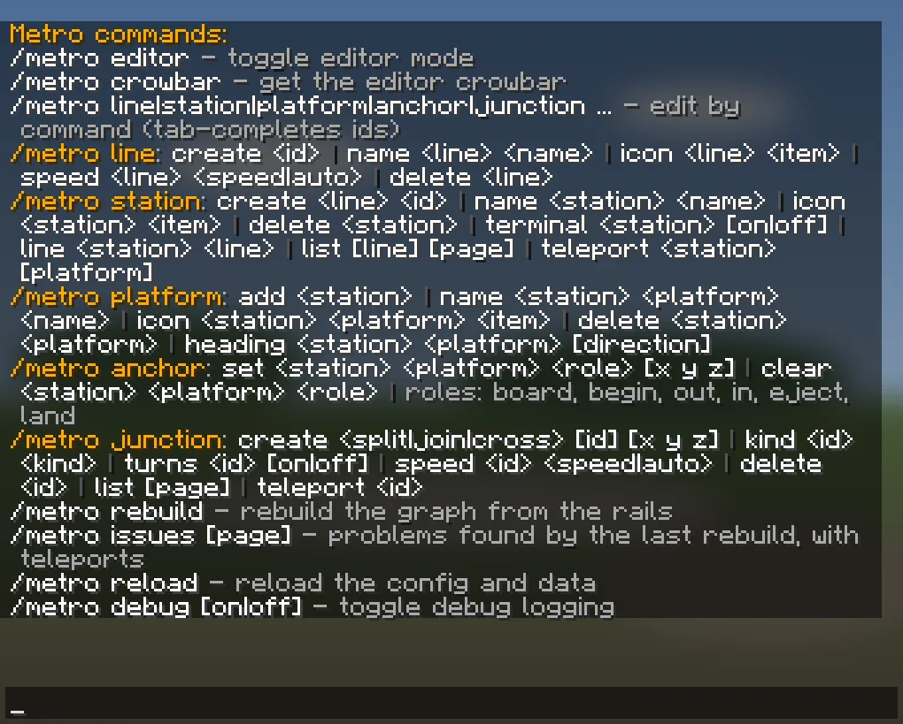

# Commands

`/metro`, or `/metro help`, lists the commands you may use. Commands you may not use do not show up in tab
completion. Ids tab-complete.

## Riding
Riders need no command, only `metro.ride` (everyone has it by default). See
[[Riding]].

`/metro version` shows the Metro version. Everyone can use it. With `metro.debug` it also shows the server version.

## Building (`metro.build`)

| Command | What it does | Page |
| --- | --- | --- |
| `/metro editor` | Turn editor mode on or off. | [[Editor-Mode]] |
| `/metro crowbar` | Get the crowbar. | [[Editor-Mode]] |
| `/metro line create\|name\|icon\|speed\|delete ...` | Edit lines. | [[Lines]] |
| `/metro station create\|name\|icon\|terminal\|line\|list\|teleport\|delete ...` | Edit and find stations. | [[Stations-and-Platforms]] |
| `/metro platform add\|name\|icon\|heading\|delete ...` | Edit platforms. | [[Stations-and-Platforms]] |
| `/metro anchor set\|clear ...` | Set or remove an anchor. | [[Anchors]] |
| `/metro junction create\|kind\|turns\|speed\|delete\|list\|teleport ...` | Edit and find junctions. | [[Junctions]] |
| `/metro rebuild` | Build the routes again from the rails. | [[Maintenance]] |
| `/metro issues [page]` | Show the problems the last rebuild found. | [[Maintenance]] |
| `/metro teleport <world> <x> <y> <z>` | Go to a block. The `[tp]` links of `/metro issues` use it. The world is a key such as `minecraft:overworld`. | [[Maintenance]] |

`delete` commands delete at once. Only the **Delete** buttons in the menus ask
first.

## Admin

| Command | Permission | What it does |
| --- | --- | --- |
| `/metro reload` | `metro.reload` | Read `config.yml`, `lang.yml` and `data.yml` again. See [[Maintenance]]. |
| `/metro debug [off\|1\|2\|3] [own\|all\|<player>]` | `metro.debug` | Watch debug lines. See below. |

## Debug logging

`/metro debug` without arguments switches level 1 on or off. Level 1 shows a few events that are safe on a live
server. Level 2 adds the decisions behind them. Level 3 adds per-tick detail. Chat shows levels 1 and 2, at most
five lines per second. Level 3 is for the console only.

| Level | Shows |
| --- | --- |
| 1 | a ride starting, arriving or ending early (with the reason), a rebuild finishing, data loading |
| 2 | the route and speeds of a ride, rails it changes and restores, rebuild steps, refusals to board, rescues, chunk preload totals, data saving |
| 3 | every chunk a ride holds, every chunk ticket added or removed, planned rail changes, and the position and speed every 10 blocks |

A line starts with `[DL1]`, `[DL2]` or `[DL3]` (green, yellow, red in chat), then `[<player>]` if it is
about a player. When chat drops lines, it shows `[DL] N lines suppressed`.

The scope says whose lines you see. By default a player sees their own lines (`own`) and the console sees
`all`. The scopes `all` and `<player>` (a player name) need `metro.admin` for a player. `on` means level 1.
The console has no `own` scope.
Nobody watches after a restart, and a player stops watching on leaving the game.

## Permissions

| Permission | Default | Allows |
| --- | --- | --- |
| `metro.ride` | everyone | boarding |
| `metro.build` | operators | all commands under Building, and the crowbar |
| `metro.reload` | operators | `/metro reload` |
| `metro.debug` | operators | `/metro debug` |
| `metro.admin` | operators | all of the above |

## Long lists
`/metro issues`, `/metro station list` and `/metro junction list` show 10 lines
at a time, with `« Previous   Page 1/3   Next »` below. Click an arrow, or add
the page number to the command. The console always gets the whole list.
