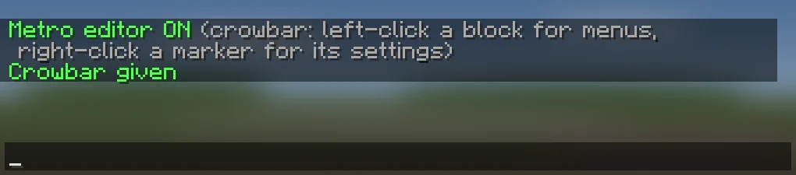
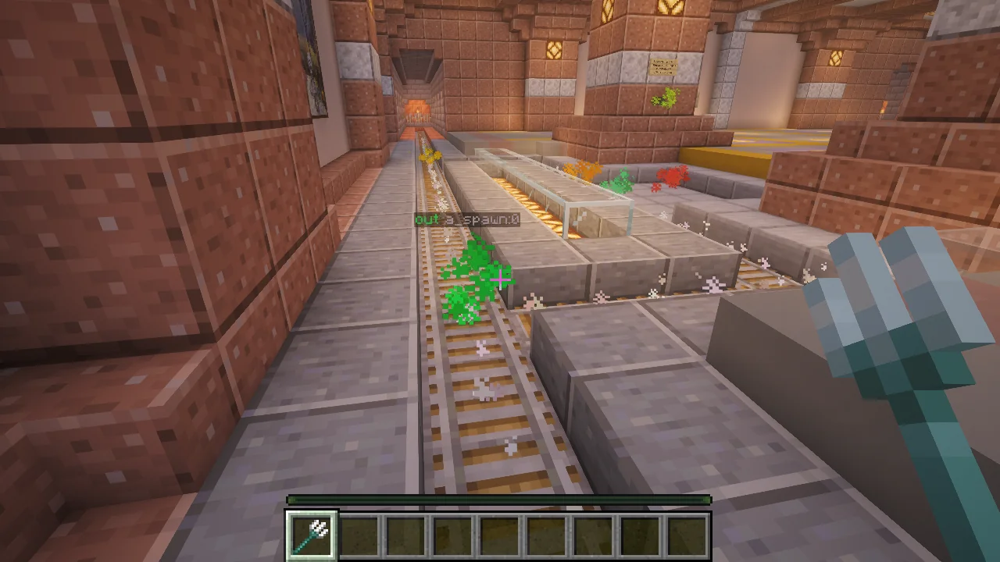
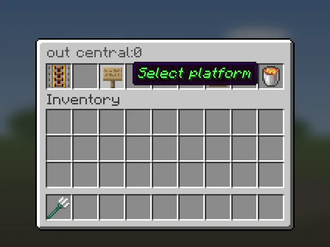
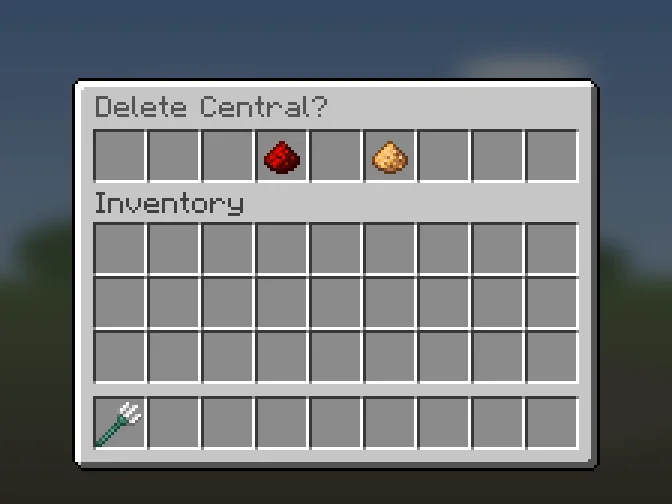
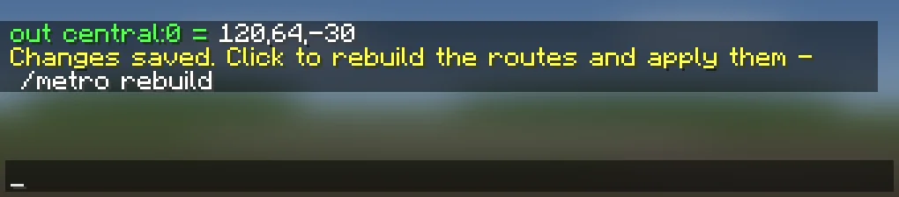

# Editor mode

You build the network in the world, not in a file. You need `metro.build`.

## Start
1. `/metro editor` turns editor mode on or off for you.
2. `/metro crowbar` gives you the crowbar (a trident by default, named **Metro crowbar**; see
   `authoring.crowbar-material` in [[Installation]]).
   In editor mode, any item of the crowbar's type works.

Editor mode ends when you leave the server, and the plugin forgets your
selection.

## What you see
In editor mode the plugin draws particles near you (48 blocks by default,
`preview.radius` in [[Installation]]):

- a white line along every route the plugin knows;
- a coloured puff on every anchor and junction. The colour is the same as the
  anchor or junction name in the menus.

Look at an anchor or a junction (up to 6 blocks away, also through blocks) and
a label floats above it:

- an anchor shows its role and platform: `out a_spawn:0`;
- a junction shows its kind and id: `split j1`. A crossing without turns adds
  `turns off`, and a junction with its own speed adds `speed 0.4`.

`a_spawn:0` means platform `0` of station `a_spawn`. Chat, labels and warnings
always use this form.

The white line shows the routes from the last `/metro rebuild`. If it is
missing between two points, rides cannot go there yet.

## Left-click: the menus
Left-click any block with the crowbar. Which menu opens depends on what you
selected before:

1. nothing: the lines menu ([[Lines]]);
2. a line: its stations menu ([[Stations-and-Platforms]]);
3. a station: its platforms menu ([[Stations-and-Platforms]]);
4. a platform: its anchor menu ([[Anchors]]).

The plugin remembers your selection, so the next left-click takes you back to
the same platform. Use the buttons in the menus to go to another line, station
or platform.

The block you left-clicked matters in the anchor menu: clicking an anchor
button puts that anchor on this block. The anchor menu also has **New
junction** (a lever), which puts a junction on this block ([[Junctions]]).

## Right-click: settings of a marker
Look at an anchor or a junction (its label shows) and right-click with the
crowbar. If nothing is in sight, the action bar says `No anchor or junction in
sight`. The trident is never thrown in editor mode.

On an anchor:

| Button | What it does |
| --- | --- |
| **Select platform** | Selects this platform and opens its anchor menu. |
| **Platform settings** | Opens the platform settings. |
| **Station settings** | Opens the station settings. |
| **Clear** | Removes this anchor at once. |

On a junction, see [[Junctions]].

## How the menus work
- **Name**, **Icon**, **Speed** and the **New ...** buttons for lines and
  stations close the menu and post a clickable line in chat. Click it to put
  the command in your chat box, type the value and press Enter. Icons take an
  item id such as `red_concrete` (it tab-completes).
- **Delete** (a lava bucket) always asks first: **Yes, delete** or
  **Cancel**.
- **Back** (an arrow) is in the bottom-right slot.
- A tooltip shows the current value, such as `Now: east` or the coordinates of
  an anchor. Anchors that are set glow.

## Save and rebuild
Every edit is saved at once. Edits that change the track (anchors, directions
of travel, junctions, line speeds, moving a station to another line, deletes)
also need `/metro rebuild` before rides use them. Chat then shows `Changes
saved. Click to rebuild the routes and apply them`. Click it, press Enter, and
the rebuild starts. Do all your edits first and rebuild once at the end.

Names, icons and the terminal flag work at once, without a rebuild.

A deleted line, station, platform or junction leaves the routes at once, so no
ride goes there even before the rebuild.

If `data.yml` failed to load, nothing can be saved. Every edit then answers
`Not saved: data.yml failed to load, see console`. See
[When data.yml can't be read](Maintenance#when-datayml-cant-be-read).

## Rules the editor checks
- An anchor must be in the same world as its station.
- A junction and a rail anchor (`begin`, `out`, `in`, `eject`) cannot be on the
  same rail block. Use the next block along the track.
- Only one junction can be on a rail block.
