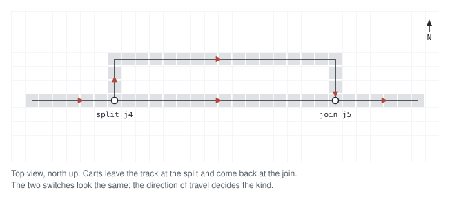
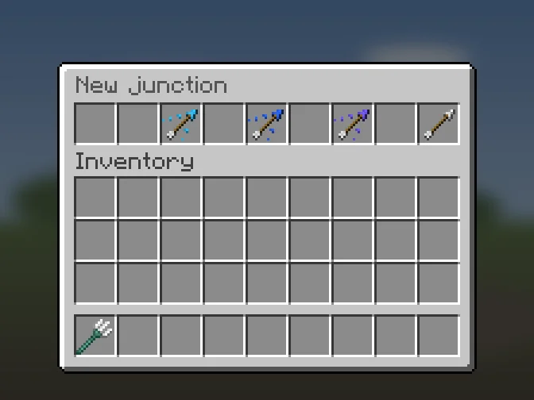
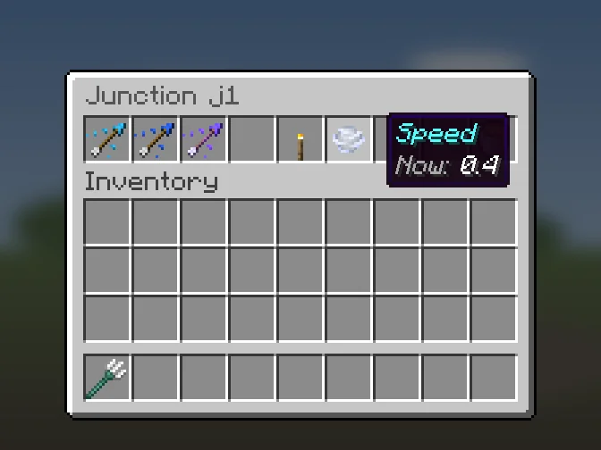
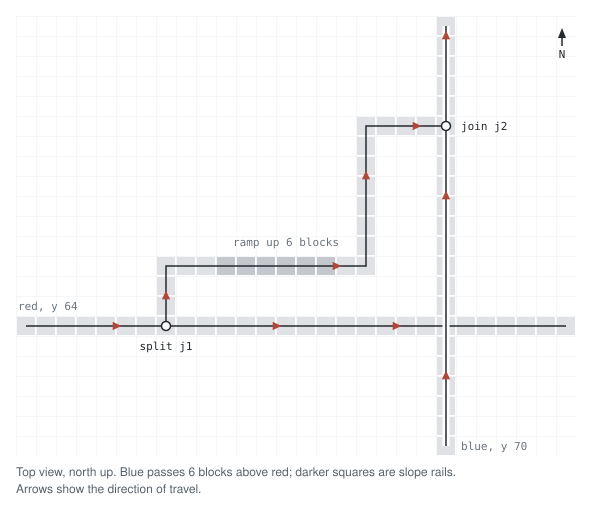
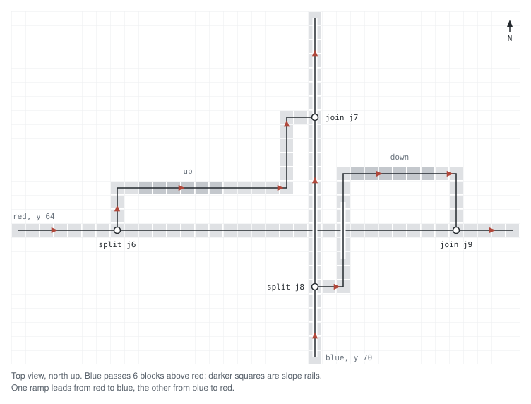
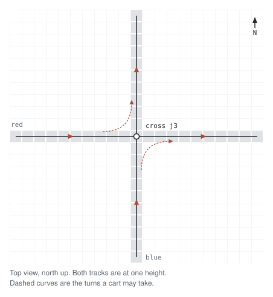
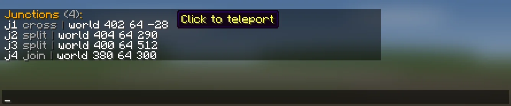

# Junctions

A junction is a switch rail that you mark for the plugin. It lets a cart go
from one track to another, so a rider can reach another line without getting
out. A junction is not part of a station.

You must mark every junction by hand. A rail that leaves the track and a rail
that comes in look the same, so the plugin cannot tell them apart.

## Kinds

| Kind | The rail | What carts do |
| --- | --- | --- |
| `split` | A straight track with one rail at the side | Leave the straight track by the side rail. |
| `join` | A straight track with one rail at the side | Come onto the straight track from the side rail. |
| `cross` | Two straight tracks crossing on one block | Go straight on both tracks, and turn onto the other track if turns are on. |

`split` and `join` look the same in the world. Pick `split` where carts leave
the track and `join` where they come in.



## Place a junction
With the crowbar ([[Editor-Mode]]): left-click the switch rail, click **New
junction** (lever) in the anchor menu, then pick **Split**, **Join** or
**Cross**. The junction gets an id `j1`, `j2` and so on, and chat tells you
which.



With a command, look at the rail and run:

```
/metro junction create <split|join|cross> [id] [x y z]
```

Without an id the plugin picks the next free `j<n>`. Coordinates only work after
an id: `/metro junction create split leave 120 64 -30`. The junction snaps to
the nearest rail.

Run `/metro rebuild` after you create, change or delete a junction.

## Junction settings
Right-click a junction with the crowbar.

| Button | What it does |
| --- | --- |
| **Split**, **Join**, **Cross** | Change the kind. The current kind glows. |
| **Turns** (crossings only) | Turn turns on or off. A torch means on, a redstone torch means off. |
| **Speed** | Posts `/metro junction speed <id>` in chat. It only matters for splits and joins. |
| **Delete** | Deletes the junction. Asks first. |



## A ramp between two lines
Two lines pass each other at different heights. A ramp links them.

1. Put a `split` on the track that carts leave.
2. Build the ramp with normal rails. It needs no marks.
3. Put a `join` on the track that carts come onto.



To go both ways, build a second ramp with its own `split` and `join`.



## A crossing
Two tracks cross on one block, at the same height. Mark the block as `cross`.
Carts go straight on both tracks. With turns on (the default), a cart can also
turn onto the other track, but only in that track's direction of travel. Turn
them off with:

```
/metro junction turns <id> off
```



The plugin changes the rail shape while a cart passes. Two carts on a crossing
at the same time can get in each other's way. Where traffic is heavy, build a
ramp instead: then the two lines never share a block.

A route never goes back through another platform of the station where the
rider boarded. So a crossing does not turn riders around. They must board on
the platform that goes their way.

## Rules
- Put a junction on a flat, straight piece of track, never on a slope or a
  curve.
- A `split` or `join` rail has rails on both ends of the straight track and on
  one side. A `cross` rail has rails on all four sides.
- A `split` side rail must go on in the direction of travel. A side rail that
  bends back the way carts came would need a turn of about 135 degrees, and
  the plugin leaves it out. The same goes for a ramp that comes into a `join`
  against the travel of its track.
- Each track through a junction needs a direction of travel. Set it on a
  platform of that track ([[Anchors]]).
- Keep at least 2 blocks of height between a track and a track that passes
  over it, so carts fit. Rails one block apart in height only connect through
  a slope rail.
- A junction and a rail anchor (`begin`, `out`, `in`, `eject`) cannot share a
  rail block. Only one junction fits on a rail block.

## Junction speed
At a junction's switch the cart slows down to the junction's speed, or to
`speed.branch` (0.3) if it has none. This switch zone is the switch block and
the next two blocks of a branch that leaves a `split`, or the last two blocks
of a ramp that comes into a `join` from the side. The rest of the branch runs at
`speed.cruise`. The switch is never faster than the track around it. A `cross`
has no switch zone, so the speed does nothing there.

```
/metro junction speed <id> <speed|auto>
```

The speed is in blocks per tick and must be at least 0.05. A value above
`speed.max` is lowered to it, and chat tells you. `auto` removes it. Run
`/metro rebuild` after you change it.

## Check your work
- `/metro junction list [page]` lists every junction with its kind and place.
  Click one to go there, or run `/metro junction teleport <id>`.
- After `/metro rebuild`, `/metro issues` lists junction problems. Each one has
  a `[?]` link to its fix in [Rebuild warnings](Maintenance#rebuild-warnings):
  - [Junction has no rail](Maintenance#junction-has-no-rail)
  - [Two junctions on one rail](Maintenance#two-junctions-on-one-rail)
  - [Junction does not fit](Maintenance#junction-does-not-fit)
  - [Split entered from the side](Maintenance#split-entered-from-the-side)
  - [Join ramp against travel](Maintenance#join-ramp-against-travel)
  - [Split branch leads nowhere](Maintenance#split-branch-leads-nowhere)
  - [Junction path has no direction](Maintenance#junction-path-has-no-direction)
  - [Junction not used](Maintenance#junction-not-used)
  - [Anchor on a junction](Maintenance#anchor-on-a-junction)
  - [Unmarked switch](Maintenance#unmarked-switch)



## Commands

| Command | What it does |
| --- | --- |
| `/metro junction create <split\|join\|cross> [id] [x y z]` | Create a junction on the rail you look at, or at `x y z`. |
| `/metro junction kind <id> <split\|join\|cross>` | Change its kind. |
| `/metro junction turns <id> [on\|off]` | Allow or block turns at a crossing. Without `on` or `off` it switches. |
| `/metro junction speed <id> <speed\|auto>` | Set the speed at its switch. |
| `/metro junction delete <id>` | Delete it at once. It does not ask first. |
| `/metro junction list [page]` | List all junctions. |
| `/metro junction teleport <id>` | Go to a junction. |

Junction ids use only lowercase letters, digits, `_` and `-`; the command refuses
any other id.
