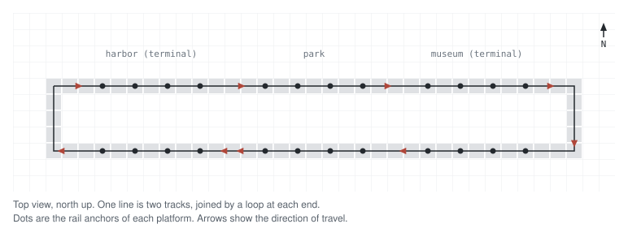
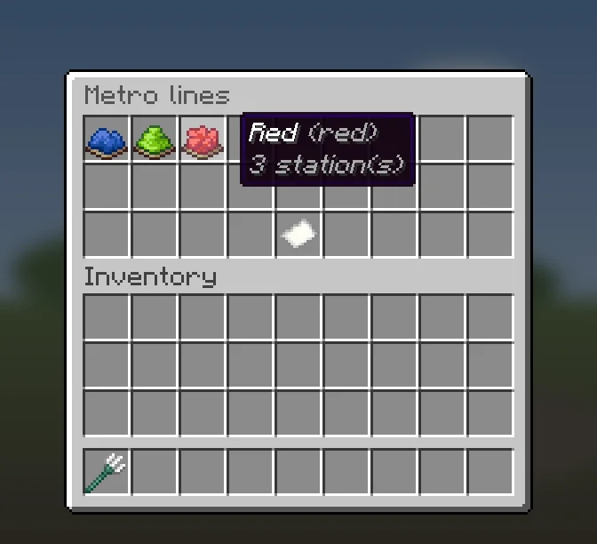
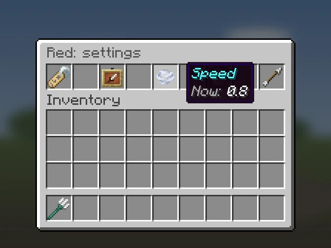
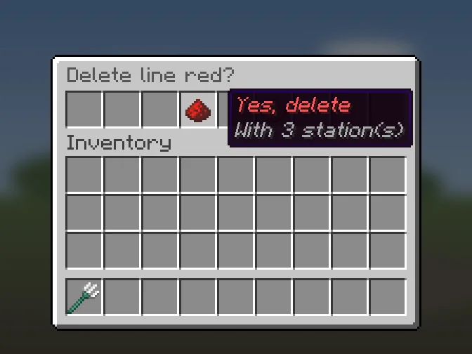

# Lines

A line is a group of stations with a name and an icon. Riders see the line
name in the boarding menu when a station is on another line.

## Build each line as a loop
Carts only run forward, in the direction of travel. They never back up. So
each line is a closed loop: two parallel tracks, one for each direction, joined
by a turning loop at each end. Stations sit along the loop, with a platform on
each track. The plugin is made for this shape.

Mark the stations at the two ends as terminal stations, so rides do not go
around the end loop and back along the same line
([Terminal stations](Stations-and-Platforms#terminal-stations)).

## Lines menu
Left-click with the crowbar when nothing is selected ([[Editor-Mode]]). Click a
line to select it and open its stations. **New line** (paper) posts
`/metro line create` in chat.

## Line settings
Open them with **Settings** (comparator) in the stations menu.

| Button | What it does |
| --- | --- |
| **Name** | Posts `/metro line name <line>` in chat. |
| **Icon** | Posts `/metro line icon <line>` in chat. |
| **Speed** | Posts `/metro line speed <line>` in chat. The tooltip shows the speed, or `auto`. |
| **Delete** | Deletes the line and all its stations. Asks first. |

Before it deletes, the menu shows how many stations go with the line.

## Commands

| Command | What it does |
| --- | --- |
| `/metro line create <id>` | Create a line and select it. |
| `/metro line name <line> <name>` | Set the name riders see. |
| `/metro line icon <line> <item>` | Set the menu icon. |
| `/metro line speed <line> <speed\|auto>` | Set the line's own speed, or go back to `speed.cruise`. |
| `/metro line delete <line>` | Delete the line and its stations at once. It does not ask first. |

An id uses only lowercase letters, digits, `_` and `-`; the command refuses any
other id. A new line starts with its id as its name.

## Line speed
By default carts run at `speed.cruise` (0.6 blocks per tick) between stations.
`/metro line speed <line> <speed>` gives one line its own speed, in blocks per
tick. `auto` removes it.

- A speed above `speed.max-cruise` (1.0 by default) is lowered to it, and chat
  tells you.
- A speed below 0.05 is refused.
- Run `/metro rebuild` after you change it.

The line speed is used only on track between two stations of this line. Track
to or from a junction, and track between stations of different lines, runs at
`speed.cruise`. A cart that passes a station without a stop runs at
`speed.through`, or at the line speed if that is lower. A cart that stops at a
platform slows down to `speed.station`. On a slope, up or down, a cart runs
at `motion.slope-speed` at most (see [[Installation]]).
