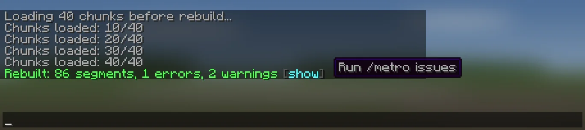
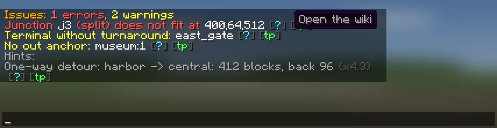
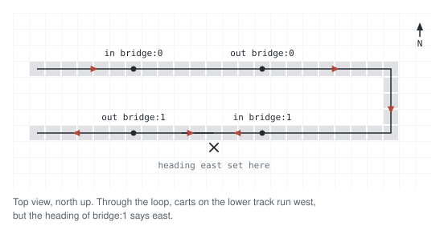
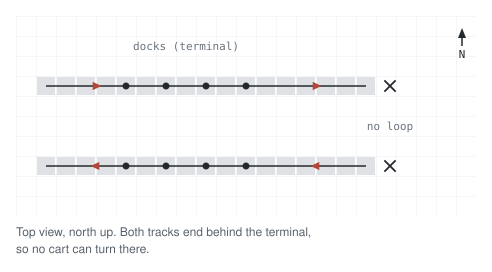
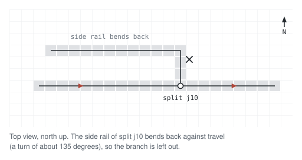
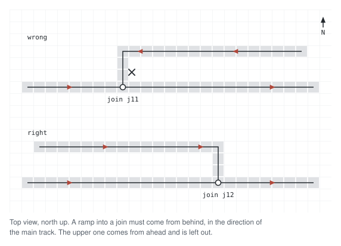
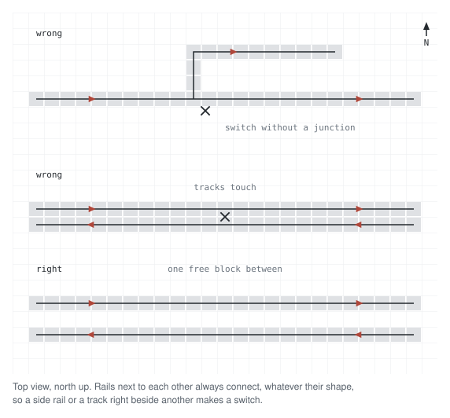

# Maintenance

## `/metro rebuild`
Builds all routes again from the rails in the world. Run it after you change
rails, anchors, directions of travel, junctions or speeds. Nothing else
rebuilds the routes: not the editor, not a server start. Until you rebuild,
rides use the routes saved in `data.yml`.

1. The plugin loads the chunks along the network in the background. Chat shows
   `Loading N chunks before rebuild...` and then `Chunks loaded: done/total`.
2. It builds the routes and saves them.
3. Chat shows `Rebuilt: N segments, X errors, Y warnings`. If there are
   problems, click `[show]` to open `/metro issues`.

A second `/metro rebuild` is refused while one runs. If the rebuild fails, chat
says so, the server log has the error, and the saved routes stay as they were.

## `/metro reload`
Reads `config.yml`, `lang.yml` and `data.yml` again. Use it after you edit one
of them by hand. It does not rebuild the routes. If you changed anchors,
junctions or speeds in a file, run `/metro rebuild` after it.

`/metro reload` is refused while a rebuild runs. After a reload,
`/metro issues` has nothing to show until the next rebuild.

If a station in `data.yml` has two platforms with the same id, the second one
gets a new id, and the console says so. Run `/metro rebuild` to link it again.

### When `data.yml` can't be read
If `data.yml` has a syntax error, the console shows an error and the network
loads empty. The plugin keeps a copy as `data.yml.broken-<date>-<time>` and
saves nothing, so your file is not lost. Every edit in game answers `Not saved:
data.yml failed to load, see console`.

To fix it, correct the error in `data.yml` and run `/metro reload`.

### Worlds that aren't loaded
Stations, junctions and routes in a world that is not loaded are left out of
the network, but kept in `data.yml` without changes. The console names each
such world. When the world is loaded, run `/metro reload`.

## `/metro issues`
Lists what the last `/metro rebuild` found. Errors (red) come first: they left
something out of the routes. Warnings (yellow) come next. Each problem is one
line, followed by:

- `[?]`: opens its section on this page;
- `[tp]`: takes you to the junction, block, platform or station it is about.

`No issues found` means the last rebuild found nothing. `No rebuild since start
or reload` means there is nothing to show yet: click `[/metro rebuild]`.
Problems with a station, platform or junction that you deleted after the
rebuild are not shown.

Under **Hints** at the end come the [one-way detours](#one-way-detours).

### One-way detours
`One-way detour: <from> -> <to>: <n> blocks, back <m> (x2.5)`

The ride from one station to the other is at least twice as long as the ride
back, because the cart has to go far before it can turn. The list shows the 10
worst pairs. A crossing with turns, or a link between the two tracks near these
stations, makes the ride shorter ([[Junctions]]). `[tp]` takes you to the
first station.

## Rebuild warnings
Each section starts with the line `/metro issues` shows.

### No direction of travel
`No direction of travel: central:0`

The plugin does not know which way carts run past this platform, so it gets no
route. Stand on the track, look the way carts go, and click **Direction** in
the platform settings, or run `/metro platform heading <station> <platform>`.
A platform with pockets always needs this, unless another platform on the same
track has a direction. One platform per track is enough. See [[Anchors]].

### Opposite directions meet
`Opposite directions meet: central:0:out`

This is an error. Two directions of travel on the same track do not agree, and
they meet at this point. Check `/metro platform heading` on the platforms of
this track. Keep only directions that agree, and set the others to `auto`.

### Terminal without turnaround
`Terminal without turnaround: <station>`

The station is a terminal, but its track does not loop around to its other
platform. Riders cannot ride through a terminal, so to go on they must get off
and board again. That is fine at a real end of a line, or if you build the loop
later. If the station is not the end of a line, turn the flag off:
`/metro station terminal <station> off`. See
[Terminal stations](Stations-and-Platforms#terminal-stations).

### Boarding leads nowhere
`Boarding leads nowhere: central:0`

Riders can board here (`board`, `begin` and `out` are set), but the track only
leads back into the same station, so there is no ride. If the platform is only
for getting off, clear its `board` anchor. Otherwise check the track after
`out`.

### No out anchor
`No out anchor: central:0`

The platform has `board` and `begin` but no `out`, so no route leaves it. Set
`out` where the platform track reaches the main line. If the platform is only
for getting off, clear its `board` anchor. See [[Anchors]].

### Junction has no rail
`Junction <id>: no rail`

This is an error. There is no rail at the junction, so it is left out. Put the
rail back, or delete the junction and place it again on the rail.

### Two junctions on one rail
`Junction <id>: another junction at x,y,z`

This is an error. Two junctions are on the same rail block, and the second one
is left out. Delete one of them.

### Junction does not fit
`Junction <id> (<kind>) does not fit at x,y,z`

This is an error. The rails around the block do not match the kind, so the
junction is left out. A junction must be on a flat, straight piece of track. A
`split` or `join` has rails on both ends of the straight track and on one side.
A `cross` has rails on all four sides. See [[Junctions]].

### Split entered from the side
`Split <id> entered from the side at x,y,z`

A track comes into this `split` through its side rail. Carts come onto the main
track there, so it is probably a `join`: change its kind.

You also see this when the side rail of a `split` bends back the way carts
came. Taking it would need a turn of about 135 degrees, so the branch is left
out. If carts come off that side track onto the main track, make it a `join`.
Otherwise check the direction of travel of the main track.

### Join ramp against travel
`Join <id>: ramp enters against travel at x,y,z`

A ramp comes into this `join` from the side, but against the direction of the
main track. A cart would have to turn about 135 degrees, so the ramp is left
out. Rebuild the ramp so it meets the main track in the same direction, or
check the direction of travel of both tracks (see
[No direction of travel](#no-direction-of-travel)).

### Split branch leads nowhere
`Split <id>: branch leads nowhere`

The side rail of this `split` does not reach any station or junction. Finish
the branch and end it at a station or a `join`.

### Junction path has no direction
`Junction <id>: no direction on x`

No direction of travel reaches this track of the junction (`x` or `z` is the
axis of the track), so the plugin does not know which way carts run there. Set
the direction on a platform of that track (see
[No direction of travel](#no-direction-of-travel)). A ramp into a `join` on a
track without a direction shows this too.

### Unmarked switch
`Unmarked switch at x,y,z`

A rail on the network has rails on three or more sides, and no junction marks
it. Rails that lie next to each other at the same height always connect,
whatever their shape. So two parallel tracks need at least one free block
between them, and a side rail needs a junction.

### Junction not used
`Junction <id>: not used by any track`

The junction fits its rails, but no route reaches it. Most often the track to
it has no direction of travel yet (see
[No direction of travel](#no-direction-of-travel)), the track does not reach
any station, or the junction is on a rail that is not part of the metro.
Connect the track, or delete the junction.

### Two anchors on one rail
`Anchors out central:0 and in central:1 share a rail block at x,y,z`

Two `out` or `in` anchors are on the same rail block. The anchor named second
gets a route, the one named first gets none. Move one of them to its own block.
`[tp]` takes you to the one left out.

### Anchor on a junction
`Anchor out central:0 is on the rail of junction <id> at x,y,z`

An `out` or `in` anchor is on a junction's rail block, so it never gets a
route. Move the anchor one block along the track. The editor does not allow
this, so it only happens after a hand edit of `data.yml` or after the rails
around it changed.

### Search gave up
`Search gave up at central:0:out after 5000 rail blocks`

The search for the next point along the track stopped after
`rebuild.max-search` rail blocks (5000 by default). Most often the track runs
onto rails that are not part of the metro, or a branch is not finished. If the
next point really is that far, raise the limit in `config.yml`. A higher limit
makes the rebuild slower, because it loads every chunk on the way.
