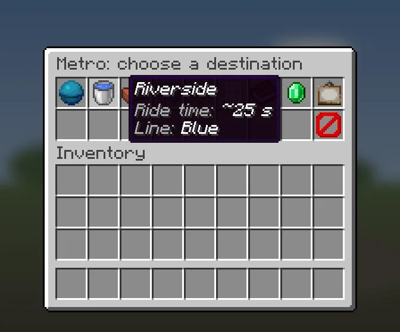
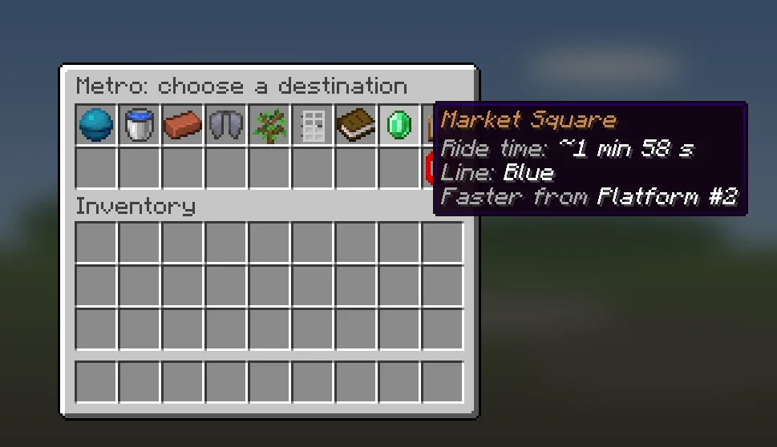
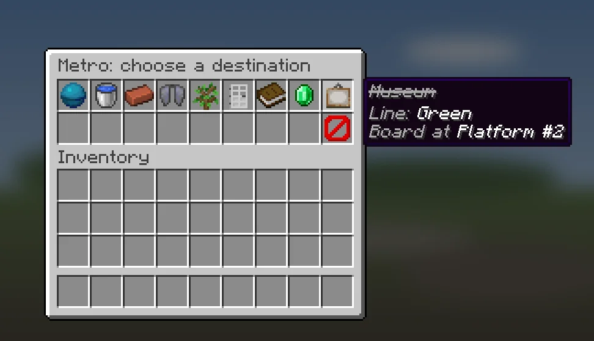
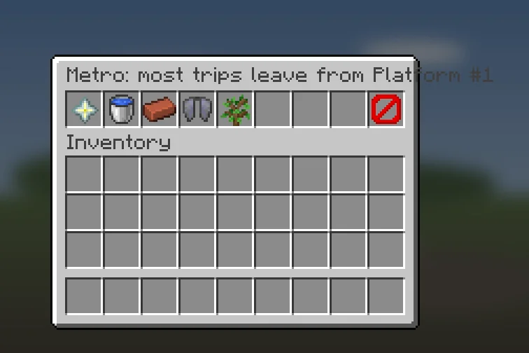
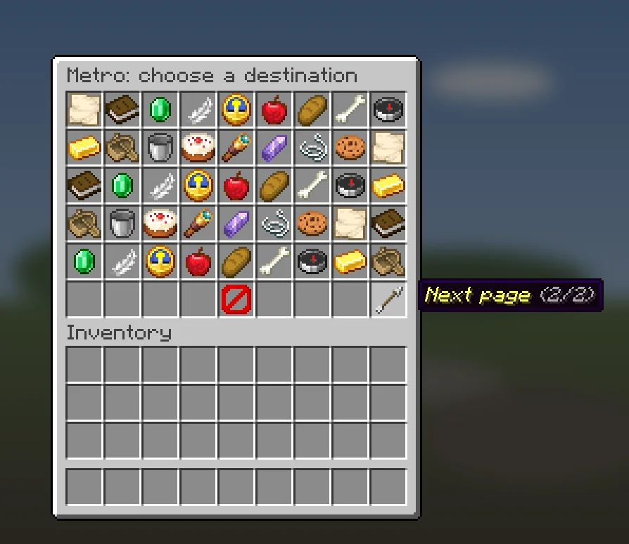
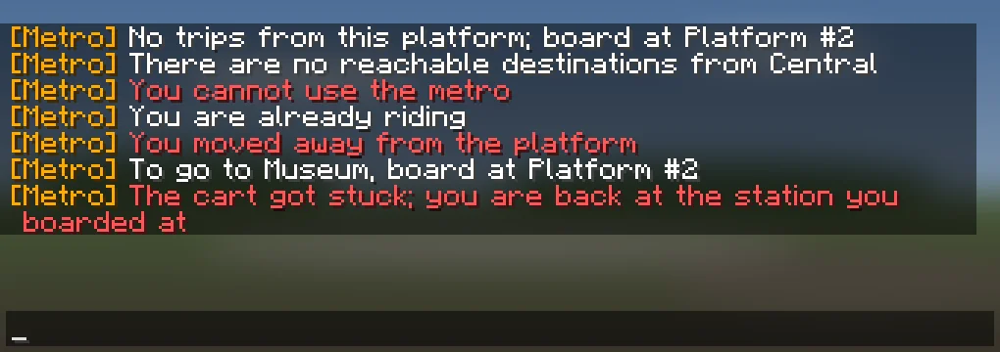
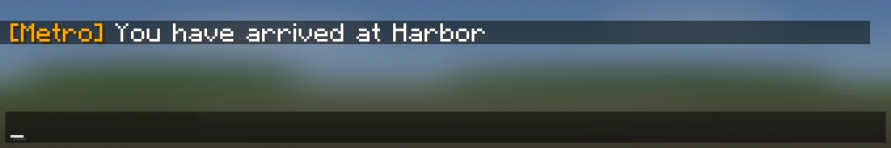
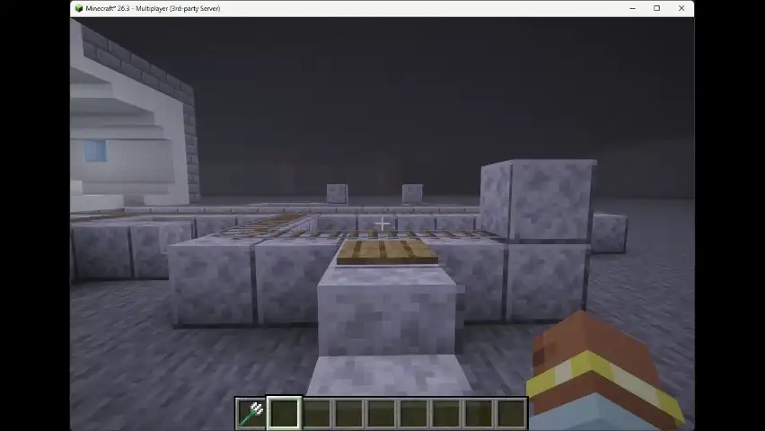

# Riding the metro

## Boarding
1. Go to a platform and press its button, or step on its pressure plate.
2. A menu opens: **Metro: choose a destination**. Each station shows its ride
   time. A station on another line also shows `Line: <name>`.
3. Click a station. A cart appears on the track with you in it and leaves.

The menu lists stations in this order, fastest first in each group:

| How the name looks | What it means |
| --- | --- |
| normal | This platform is the fastest way there. |
| orange | You can ride from here, but the platform named under it (`Faster from ...`) is faster, even with the walk to it. |
| struck through | No ride from this platform. The tooltip says where to board (`Board at ...`). Clicking it closes the menu and tells you the same in chat. |

If the title says **Metro: most trips leave from ...**, you are on the wrong
platform for most trips. Walk to the one it names.

A station that is not in the menu at all has no route from this station yet.
A ride never passes through another platform of the station you board at, and it does
not pass a terminal and come back along the same line (see
[[Stations-and-Platforms#terminal-stations]]). A destination that needs either is not listed.

If there are more stations than fit, the menu shows 45 on a page. Use the
arrows in the bottom corners to turn the page.

### Changed your mind?
Click **Exit** (the barrier) or close the menu. Nothing happens. To open it
again on a plate, step off and back on.

If you are pushed or teleported away while the menu is open, the boarding is
cancelled: `You moved away from the platform`.

### No menu?
Chat tells you why:

| Message | What to do |
| --- | --- |
| `No trips from this platform; board at ...` | Walk to the platform it names. |
| `There are no reachable destinations from ...` | No route leaves this station yet. Tell a builder. |
| `This platform has no boarding point (begin) yet` | Tell a builder: the platform has no `begin` anchor. |
| `There is no route to <station> from here` | The route is gone since the menu opened. Open the menu again. |
| `Could not board the cart` | Try again. |
| `You cannot use the metro` | You do not have `metro.ride`. |
| `You are already riding` | Finish your ride first. |

## During the ride
The cart drives itself. You cannot get out or sneak while it moves, and no one
can push, hit or break the cart.

The cart runs at the speeds in `config.yml` (`speed` and `motion` in [[Installation]]), in blocks
per tick. It brakes before stations, sharp turns, junction switches and slopes, and never goes
faster than `speed.max`.

If the cart gets stuck and does not move for 5 seconds, the ride ends. You are
put back on the platform where you boarded, and chat tells you why: the cart got stuck, the cart disappeared,
you left the cart, the ride failed or the server is stopping. Most messages also say how many blocks you had
travelled and where you were going, which helps when you report a problem.

If you leave the game or die during the ride, you go back to that platform too:
when you join again, or when you respawn. This also works after a server restart.

## Getting off
At your station the cart stops and waits a moment (one second by default). Then it sets you down
on the platform, and chat says `You have arrived at <station>`. To get off at
once, press Shift while the cart waits.

If you leave the game or die while the cart waits at your station, it counts as
an arrival. You are not sent back.

## See it in action

