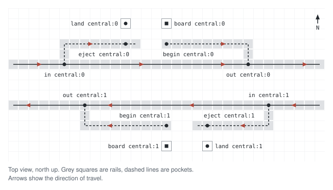
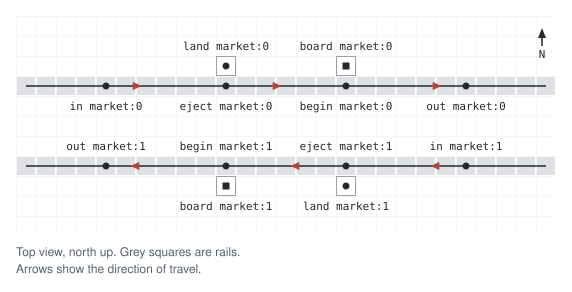
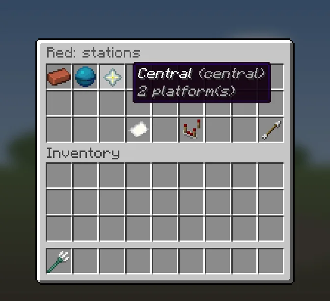
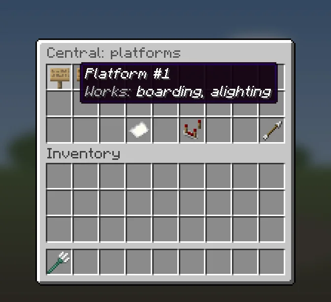
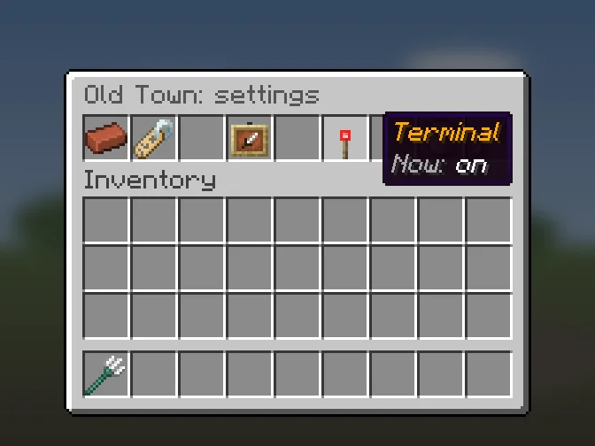
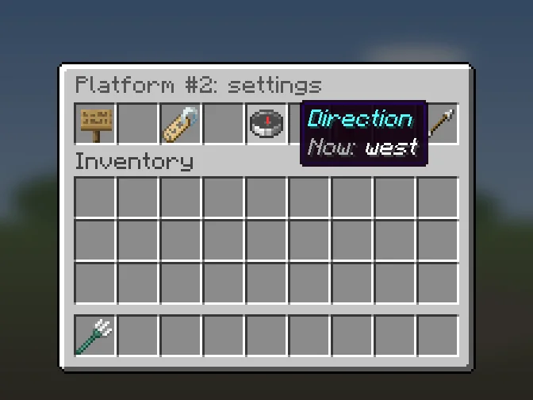
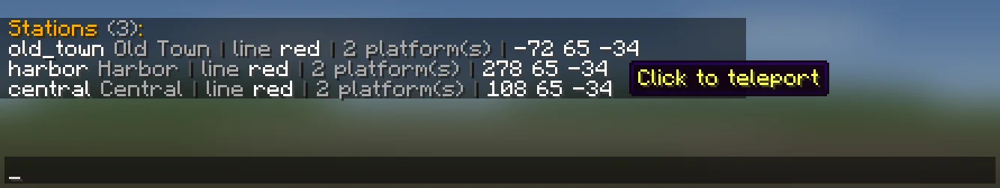

# Stations and platforms

A station is a stop on a line. It has one or more platforms. A platform is the
place where riders board or get off, on one track. Most stations have two
platforms, one on each track of the line, but any number works.

Each platform has its own anchors, the points that tell the plugin where the
cart starts, where it stops and where the rider stands ([[Anchors]]).

## Two ways to build a platform
### With pockets
The main line runs past the station. The cart leaves from a
short side track (a pocket) that joins the main line, and it stops on another
pocket that leaves the main line. Carts that do not stop here stay on the main
line.



### On the main line
All anchors sit on one straight piece of the main line,
with no switches. A cart that stops here stops at `eject` and later leaves from
`begin`. A cart that does not stop rides over the same rails.



## Build a station
1. Build the track first: the main line and, if you use them, the pockets.
2. Select the line ([[Lines]]).
3. Create the station: **New station** in the stations menu, or
   `/metro station create <line> <id>`. It is created in your world with one
   platform, `0`, and the plugin selects it.
4. For each other track, add a platform: **New platform** in the platforms
   menu, or `/metro platform add <station>`.
5. Set the anchors of each platform ([[Anchors]]).
6. Run `/metro rebuild` and read `/metro issues` ([[Maintenance]]).
7. Ride from each platform to check it.

## Stations menu
Opens when you click a line in the lines menu. Click a station to select it and
open its platforms.

| Button | What it does |
| --- | --- |
| **New station** | Posts `/metro station create <line>` in chat. |
| **Settings** | Line settings ([[Lines]]). |
| **Back** | Lines menu. |



## Platforms menu
Opens when you click a station. Click a platform to select it and open its
anchor menu. The tooltip of each platform says what it is ready for:
`Works: boarding, alighting`, only one of them, or `Works: nothing yet`
([[Anchors]] says which anchors each one needs).

| Button | What it does |
| --- | --- |
| **New platform** | Adds a platform at once and opens its anchor menu. |
| **Settings** | Station settings. |
| **Back** | Stations menu. |



Platform ids are numbers. A new platform gets the smallest number not in use, so
after you delete `0` the next platform is `0` again, and ids can have gaps. A platform without a name shows as
`Platform #1` for id `0`, `Platform #2` for id `1`, and so on. Chat, labels and
warnings always use the id (`central:0`), never the position in the list.

## Station settings
Open them with **Settings** in the platforms menu.

| Button | What it does |
| --- | --- |
| **Name** | Posts `/metro station name <station>` in chat. |
| **Icon** | Posts `/metro station icon <station>` in chat. |
| **Terminal** | Turns the terminal flag on or off. A redstone torch means on. |
| **Delete** | Deletes the station. Asks first. |



## Platform settings
Open them with **Settings** in the anchor menu.

| Button | What it does |
| --- | --- |
| **Name** | Posts `/metro platform name <station> <platform>` in chat. |
| **Direction** | Sets the direction of travel to the way you face ([[Anchors]]). |
| **Icon** | Posts `/metro platform icon <station> <platform>` in chat. |



## Terminal stations
Mark the station at each end of a line as a terminal. A ride may then not pass
through it and come back along the same line. Rides to it, from it, and through
it to another line still work.

Turn it on with **Terminal** in the station settings, or:

```
/metro station terminal <station> [on|off]
```

Without `on` or `off` the command switches the flag. It works at once, no
rebuild needed.

The track behind a terminal should still loop around to its other platform, so
carts can turn. If it does not, you see
[Terminal without turnaround](Maintenance#terminal-without-turnaround) in
`/metro issues`, and also in chat when you turn the flag on, if a rebuild has run since the server started
or since the last `/metro reload`.

## Find a station
`/metro station list [line] [page]` lists stations with their line, number of
platforms and position. Click a station to go there.



`/metro station teleport <station> [platform]` takes you to the platform's
`land` anchor. Without `land` it uses `board`, then `begin`, then `eject`.
Without a platform it takes the first platform that has one of these.

## Commands

| Command | What it does |
| --- | --- |
| `/metro station create <line> <id>` | Create a station with platform `0` and select it. An existing id on that line is selected. |
| `/metro station name <station> <name>` | Set the name riders see. |
| `/metro station icon <station> <item>` | Set the icon. |
| `/metro station terminal <station> [on\|off]` | Set the terminal flag. |
| `/metro station line <station> <line>` | Move the station to another line. It keeps its platforms and anchors. |
| `/metro station list [line] [page]` | List stations. |
| `/metro station teleport <station> [platform]` | Go to a station. |
| `/metro station delete <station>` | Delete the station at once. It does not ask first. |
| `/metro platform add <station>` | Add a platform. |
| `/metro platform name <station> <platform> <name>` | Set a platform name. |
| `/metro platform icon <station> <platform> <item>` | Set a platform icon. |
| `/metro platform heading <station> <platform> [direction]` | Set the direction of travel ([[Anchors]]). |
| `/metro platform delete <station> <platform>` | Delete the platform at once. It does not ask first. |

Station ids use only lowercase letters, digits, `_` and `-`; the command refuses
any other id.

After you move a station to another line or delete a station or platform, run
`/metro rebuild`.
